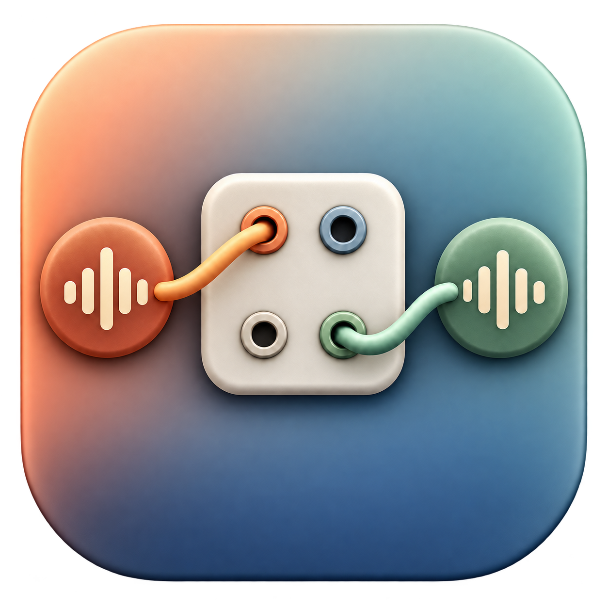

<p align="center">
  
</p>

# Audio Bridge 🎛️

A native macOS menu-bar app for bridging audio between Core Audio devices. Mix inputs into stereo, add Audio Unit effects, and route the mix to your output channels.

**macOS 14+ · SwiftUI · English / Czech · MIT**

🚧 Currently a hobby project developed and tested locally on Apple Silicon. Builds are ad-hoc signed and not notarized; broader hardware and long-run validation are still in progress.

## 🎚️ Features

- Independent input/output selection and drift compensation.
- Mono/stereo presets, input mixing matrix and stereo output fan-out.
- Installed AU effects, live editing, bypass and searchable effect selection.
- Level meters, input trim and output-device volume with gain fallback.
- Simple or Expert buffer settings, optional exclusive device access.
- Optional login launch and HTTP/OSC status and control for Companion.

## 🛠️ Build and install

Install Xcode, clone or download this repository, then run from its directory:

```sh
make doctor
make BUILD_CONFIGURATION=release sign
make verify
```

Quit any running copy, then copy `dist/AudioBridge.app` into `~/Applications` or `/Applications` and open it. For a quick run directly from the checkout:

```sh
make BUILD_CONFIGURATION=release run
```

If macOS blocks a downloaded build, use **System Settings → Privacy & Security → Open Anyway**. Alternatively, for a build you trust, remove quarantine from that app only:

```sh
xattr -dr com.apple.quarantine "$HOME/Applications/AudioBridge.app"
open "$HOME/Applications/AudioBridge.app"
```

Adjust the path if installed in `/Applications`. Locally compiled builds usually don't need this step. For File Provider/iCloud signing errors and all build targets, see the [build guide](docs/build.md).

## ▶️ Usage

1. Open **Settings → Audio**, select input/output devices and apply matching sample rates.
2. Grant microphone permission in **General**.
3. Set channel patches in **Routing** and optionally add **Effects**.
4. Press **Start** in **Bridge**. Monitor levels and output volume from the menu bar.

Device loss stops the bridge and requires local **Re-arm**. Manual **Stop** stays stopped. Keep monitoring volume low when routing a microphone to speakers.

Current support requires distinct device UIDs, matching sample rates and native packed Float32 PCM. See [compatibility](docs/device-compatibility.md), [remote endpoints](docs/remote-control.md) and the [documentation index](docs/README.md) for details.

## 🤝 Contributing

Issues and focused pull requests are welcome. For audio bugs, include your device setup and a sanitized **Diagnostics → Copy Status** report. Development commands: `make test` and `make release`. See [CONTRIBUTING.md](CONTRIBUTING.md).

## ☕ Enjoying it?

This is a hobby project. A ⭐, feedback or a useful bug report is appreciated! If you'd like to buy me a coffee, get in touch through this repository—we'll figure something out. 😄

## 📄 License

[MIT](LICENSE).
